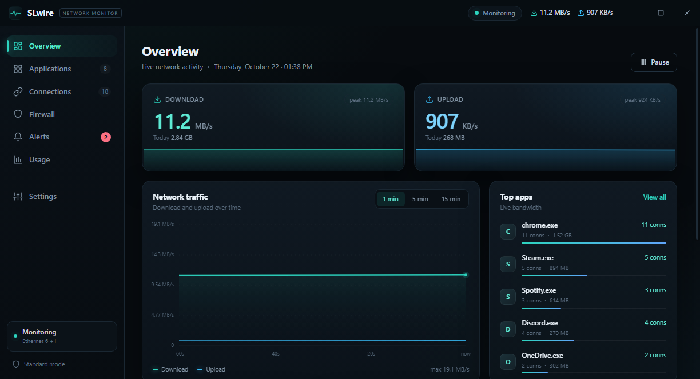

# SLwire

**Live network monitor for Windows 10 / 11.**

SLwire is a lightweight, tray-first desktop app for seeing what your Windows PC is doing on the network: live upload and download speeds, per-app usage, active connections, Windows Firewall control, alerts, and local usage history.

[**Download SLwire v1.0.0**](https://github.com/sipkaduwapromotion-creator/slwire/releases/latest) · [**Landing page**](https://sipkaduwapromotion-creator.github.io/slwire/)



## Download

| Build | File | Size |
| --- | --- | --- |
| Installer (recommended) | `SLwire-Setup-1.0.0.exe` | 89.4 MB |
| Portable | `SLwire-Portable-1.0.0.exe` | 81.4 MB |

Both builds require Windows 10/11 (64-bit) and administrator access.

### Installer SHA-256

```text
22E1259F1CC71C5422FF533A4121CE462BE2D284429EEF61F34D59A727C69A33
```

### Portable SHA-256

```text
0D967D41EBFB6C795817C51B7FD23D20F262BC5E6ED0BF12314C320AF78C5807
```

## Highlights

- **Live traffic** — real-time speeds, a rolling graph, and 1/5/15-minute averages.
- **Per-app usage** — see which processes are using data. Per-app byte counters are TCP-only.
- **Connections** — TCP/UDP endpoints, ports, state, PID, and process name.
- **Firewall control** — block or allow apps with Windows Firewall rules.
- **Alerts** — speed spikes, daily limits, new apps, and firewall changes.
- **Local history** — daily usage saved under `%APPDATA%\SLwire`.
- **Tray-first** — close to tray, reopen from the tray, or quit from the tray menu.
- **Auto-start** — a Task Scheduler task starts SLwire silently at Windows sign-in with highest privileges. Manual launches still show UAC.

## Install

1. Download the installer from the [latest release](https://github.com/sipkaduwapromotion-creator/slwire/releases/latest).
2. Run `SLwire-Setup-1.0.0.exe`. If Windows SmartScreen appears, choose **More info → Run anyway**.
3. Approve the UAC prompt. SLwire opens in the system tray.
4. Auto-start is enabled by default. You can toggle it in **Settings**.

> This is an independent, unsigned build. SmartScreen may warn on first launch. Verify the SHA-256 checksum above if you want extra confidence.

## Notes

- Per-app byte counters are TCP-only. Apps that mostly use UDP/QUIC may show little or no app-level traffic; total traffic is unaffected.
- Runtime data is stored locally in `%APPDATA%\SLwire` (`config.json`, `alerts.json`, `apps.json`, `firewall-rules.json`, and `history\YYYY-MM-DD.json`).
- Automatic startup uses a scheduled task named `SLwire`, not a Run-key entry, so it does not show a UAC prompt at sign-in.
